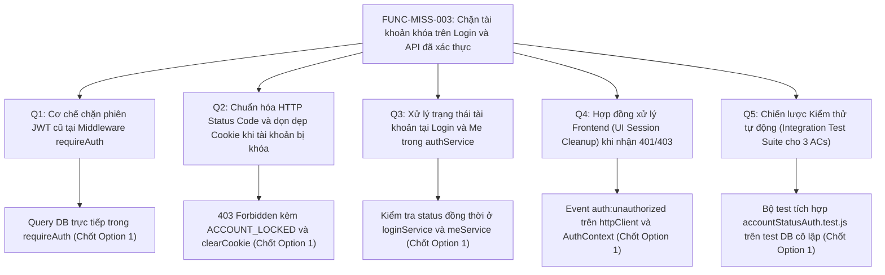

# Phỏng vấn kỹ thuật: Chặn tài khoản khóa trên login và API đã xác thực (FUNC-MISS-003)

- **Task ID:** `FUNC-MISS-003`
- **Tên task:** Chặn tài khoản khóa trên login và API đã xác thực
- **Module / Nhóm:** Trạng thái tài khoản / B. Chưa thực hiện / khắc phục
- **Mức độ ưu tiên:** P0 (Rào chắn: Quyền và riêng tư / Toàn vẹn dữ liệu)
- **Độ phức tạp / Giai đoạn:** M (Ước lượng sơ bộ) / Giai đoạn 1
- **Ngày tạo:** 2026-11-20
- **Trạng thái:** Đã hoàn thành phỏng vấn toàn bộ quyết định Q1–Q6 và đạt được sự hiểu biết chung (Shared Understanding). Sẵn sàng chuyển sang lập Kế hoạch triển khai chi tiết (`docs/task-plans/2026-11-20-chan-tai-khoan-khoa-login-va-api-plan.md`).
- **Tài liệu tham chiếu:**
  - `docs/TechStore_Master_Plan.xlsx` (Sheet Tổng quan, Chức năng, Tiêu chí kiểm thử, Lộ trình và phụ thuộc)
  - `AGENTS.md` (Quy chuẩn kiến trúc, kiểm tra trước khi bàn giao và quy tắc tài liệu)
  - `GLOSSARY.md` (Từ vựng miền nghiệp vụ TechStore)

---

## 1. Căn cứ nghiệp vụ và Hiện trạng khảo sát

### 1.1. Căn cứ từ MasterPlan (`docs/TechStore_Master_Plan.xlsx`)
- **Hiện trạng thực tế:**
  - `requireAuth` (`BE/src/middleware/requireAuth.js:19`) hiện chỉ thực hiện `jwt.verify(token, secret)` và gán `req.user = { id: payload.userId }` mà hoàn toàn không truy vấn cơ sở dữ liệu để kiểm tra sự tồn tại hoặc trạng thái tài khoản.
  - `loginService` (`BE/src/services/client/authService.js:20-48`) chỉ đối chiếu email và so khớp mật khẩu bằng bcrypt, không đưa `status` vào danh sách `attributes` truy vấn và không kiểm tra `status === 1`.
  - `meService` (`BE/src/services/client/authService.js:54-65`) chỉ truy vấn `User.findByPk(userId)` theo `USER_PRIVATE_FIELDS` (trong đó `status` vắng mặt), không kiểm tra xem tài khoản có đang hoạt động hay đã bị khóa.
  - Các middleware bảo vệ phân quyền riêng lẻ (`requireCatalogOperator`, `orderStatusService.loadActor`, `requireActiveAdmin`) đã chủ động truy vấn DB để kiểm tra `status === 1`. Tuy nhiên, toàn bộ các tuyến chỉ gắn `requireAuth` (như Cart: `GET/POST/PUT/DELETE /api/cart`, Order Customer: `POST /api/orders`, `PUT /api/orders/:id/cancel`, User Profile: `PUT /api/users/profile`, Review: `POST/PUT/DELETE /api/reviews`) vẫn mở hoàn toàn cho các JWT cũ của tài khoản đã bị khóa hoặc thậm chí đã bị xóa khỏi DB.
- **Vấn đề / Rủi ro bảo mật & toàn vẹn:**
  - Người dùng có tài khoản đã bị khóa (`status = 0`) bởi quản trị viên, hoặc tài khoản đã bị xóa, nếu sở hữu một JWT hợp lệ từ trước (thời hạn mặc định 7 ngày) vẫn có thể tiếp tục tạo đơn hàng mới (`POST /api/orders`), can thiệp giỏ hàng (`/api/cart`), cập nhật thông tin cá nhân (`/api/users/profile`), hoặc gửi đánh giá sản phẩm (`/api/reviews`).
  - Vi phạm nghiêm trọng nguyên tắc quản trị quyền truy cập: Thao tác khóa tài khoản không có tác dụng tức thì với các phiên đang tồn tại.
- **Mục tiêu:**
  - Tài khoản có `status = 0` hoặc người dùng đã bị xóa khỏi hệ thống không có quyền truy cập vào bất kỳ tài nguyên nào yêu cầu đăng nhập.
  - Khóa tài khoản phải có hiệu lực ngay lập tức với mọi phiên làm việc đang tồn tại.
- **Tiêu chí nghiệm thu (Acceptance Criteria):**
  - **`FUNC-MISS-003-AC-01`**: Tài khoản khóa không đăng nhập được.
    - *Điều kiện:* Môi trường thử nghiệm cô lập; dữ liệu giả; không dùng database cửa hàng.
    - *Dữ liệu:* `status = 0`, password đúng.
    - *Các bước:* Gọi `POST /api/auth/login`.
    - *Kỳ vọng:* Trả về 401/403 với thông báo phù hợp; tuyệt đối không cấp mới cookie phiên `auth_token`.
  - **`FUNC-MISS-003-AC-02`**: JWT cũ mất hiệu lực ngay khi tài khoản khóa/xóa.
    - *Điều kiện:* Môi trường thử nghiệm cô lập; dữ liệu giả; không dùng database cửa hàng.
    - *Dữ liệu:* User active nhận JWT rồi chuyển thành `status = 0` hoặc bị xóa trong DB thử.
    - *Các bước:* Gọi `GET /api/auth/me`, `GET /api/cart`, `POST /api/orders`, `PUT /api/users/profile`, `POST /api/reviews` sau thay đổi.
    - *Kỳ vọng:* Bị từ chối trước mutation; không có dữ liệu mới nào được ghi; cookie phiên bị vô hiệu hóa/dọn dẹp.
  - **`FUNC-MISS-003-AC-03`**: User active vẫn dùng được các luồng cũ.
    - *Điều kiện:* Môi trường thử nghiệm cô lập; dữ liệu giả; không dùng database cửa hàng.
    - *Dữ liệu:* `admin`, `staff`, `customer` đang active (`status = 1`).
    - *Các bước:* Chạy smoke login / cart / profile / order và phân quyền.
    - *Kỳ vọng:* Không giảm kiểm tra quyền Order hoặc tạo bypass qua role; các luồng hợp lệ vận hành trơn tru.

---

## 2. Cây quyết định (Design Tree)

---

## 3. Nội dung Phỏng vấn Vòng 1 (Frontier)

### ❓ Q1 - Cơ chế xử lý và vô hiệu hóa JWT cũ tại Middleware `requireAuth`
**Bối cảnh:** Hiện tại `requireAuth.js` chỉ giải mã `jwt.verify(token, secret)` rồi gán `req.user = { id: payload.userId }`. Nếu tài khoản bị quản trị viên đổi `status = 0` hoặc bị xóa khỏi cơ sở dữ liệu, JWT đó vẫn hợp lệ trên toàn bộ các route chỉ gắn `requireAuth` cho đến khi hết hạn (7 ngày). Tiêu chí `FUNC-MISS-003-AC-02` yêu cầu: *"JWT cũ mất hiệu lực ngay khi tài khoản khóa/xóa... Từ chối trước mutation; không dữ liệu mới được ghi"*.

Có ít nhất 3 lựa chọn kỹ thuật:
- **Option 1 (Truy vấn DB trực tiếp trong `requireAuth` để xác thực danh tính và `status = 1`):**
  - *Cơ chế:* Sau khi `jwt.verify` thành công, `requireAuth` thực hiện truy vấn `User.findByPk(payload.userId, { attributes: ["id", "role", "status"] })`.
    - Nếu `!user` (đã xóa) hoặc `user.status !== 1` (bị khóa): dọn dẹp cookie `res.clearCookie("auth_token", ...)` và từ chối ngay lập tức với mã lỗi phù hợp (401 cho tài khoản không tồn tại, 403 cho tài khoản bị khóa).
    - Nếu hợp lệ: gán đầy đủ `req.user = { id: user.id, role: user.role, status: user.status }` và chuyển tiếp qua `next()`.
  - *Lý do & Ưu điểm:*
    - Bảo vệ tức thì và toàn diện 100% tất cả các route đã xác thực (Cart, Order, Profile, Review, Admin Catalog...) mà không cần phải can thiệp hay sửa đổi từng route riêng lẻ.
    - Đảm bảo tính nhất quán tuyệt đối (zero latency) giữa cơ sở dữ liệu và phiên làm việc, thỏa mãn trọn vẹn `FUNC-MISS-003-AC-02`.
    - Cung cấp sẵn `req.user.role` và `req.user.status` cho các middleware phía sau, mở ra cơ hội tái sử dụng thông tin và giảm tải truy vấn lặp tại `requireCatalogOperator` hay `requireActiveAdmin`.
    - Truy vấn qua Primary Key (`findByPk`) trên MySQL có độ trễ cực thấp (< 1ms).
  - *Nhược điểm:* Mỗi HTTP request có xác thực sẽ phát sinh 1 câu truy vấn đọc người dùng theo ID.
- **Option 2 (Tách riêng middleware `requireActiveUser` và gắn thủ công vào từng router):**
  - *Cơ chế:* Giữ nguyên `requireAuth` chỉ verify JWT thuần túy. Tạo thêm middleware `requireActiveUser.js` để kiểm tra trạng thái trong DB và phải chèn middleware này vào tất cả các router cần bảo vệ (`cartRoutes.js`, `orderRoutes.js`, `userRoutes.js`, `reviewRoutes.js`...).
  - *Lý do & Ưu điểm:* Tách bạch trách nhiệm của `requireAuth` (chỉ kiểm tra token) và `requireActiveUser` (kiểm tra trạng thái nghiệp vụ).
  - *Nhược điểm:* Phải chỉnh sửa hàng loạt file route; nguy cơ rất cao bỏ sót route hiện tại hoặc route mới được tạo trong tương lai; vi phạm nguyên tắc "chặn tài khoản khóa trên API đã xác thực toàn cục".
- **Option 3 (Cơ chế Token Versioning / Invalidation List lưu trữ trong Database hoặc In-memory Cache):**
  - *Cơ chế:* Bổ sung cột `token_version` vào bảng `users` hoặc lưu danh sách JWT bị thu hồi trong Redis. Mỗi khi đổi trạng thái user, tăng `token_version`.
  - *Lý do & Ưu điểm:* Giúp quản lý phiên nâng cao và thu hồi token hàng loạt theo phiên.
  - *Nhược điểm:* Buộc phải thay đổi schema cơ sở dữ liệu (vi phạm giới hạn MasterPlan: "DB: giữ status, không thay đổi schema ở task này"); đòi hỏi bổ sung dịch vụ phụ trợ như Redis hoặc vẫn phải truy vấn DB để kiểm tra `token_version`. Vượt quá phạm vi của task Scope M.

➡️ **Đề xuất khuyến nghị (Option 1):** Tích hợp kiểm tra danh tính và trạng thái tài khoản (`status === 1`) trực tiếp tại `requireAuth.js`. Nếu tài khoản không tồn tại hoặc `status !== 1`, dọn dẹp cookie và chặn ngay lập tức.

---

### ❓ Q2 - Chuẩn hóa HTTP Status Code và Hành vi Dọn dẹp Cookie khi Tài khoản bị khóa
**Bối cảnh:** Khi tài khoản bị khóa (`status = 0`), có hai kịch bản phát sinh: (1) Đăng nhập qua `POST /api/auth/login` bằng mật khẩu đúng; (2) Gửi request đến các API đã xác thực bằng cookie `auth_token` cũ. Tiêu chí `AC-01` nêu: *"401/403 với thông báo chung; không set cookie phiên mới"*, và `AC-02` yêu cầu: *"Từ chối trước mutation; không dữ liệu mới được ghi"*.

Có ít nhất 3 lựa chọn kỹ thuật:
- **Option 1 (Phân định chuẩn REST: Trả về HTTP `403 Forbidden` kèm mã lỗi rõ ràng khi tài khoản bị khóa; trả về HTTP `401 Unauthorized` khi tài khoản không tồn tại; đồng thời dọn dẹp cookie `auth_token`):**
  - *Cơ chế:*
    - Khi login với tài khoản `status = 0`: Trả về `403 Forbidden` với payload `{ success: false, code: "ACCOUNT_LOCKED", message: "Tài khoản của bạn đã bị khóa hoặc tạm ngưng." }`, không thiết lập cookie.
    - Khi gọi Authenticated API với token của tài khoản `status = 0`: Trả về `403 Forbidden`, xóa cookie thông qua `res.clearCookie("auth_token", ...)` để trình duyệt dọn dẹp phiên rác.
    - Khi token không hợp lệ hoặc user đã bị xóa hoàn toàn khỏi DB: Trả về `401 Unauthorized` và xóa cookie.
  - *Lý do & Ưu điểm:*
    - Tuân thủ chính xác chuẩn HTTP RFC 9110: `401 Unauthorized` dành cho việc thiếu/sai thông tin xác thực danh tính; `403 Forbidden` dành cho việc danh tính đã được xác thực nhưng bị cấm truy cập tài nguyên do trạng thái nghiệp vụ (bị khóa).
    - Việc chủ động xóa cookie bằng `res.clearCookie` ngăn chặn client tiếp tục gửi lại JWT không hợp lệ trong các request kế tiếp.
    - Cung cấp mã lỗi tường minh (`ACCOUNT_LOCKED`) giúp Frontend hiển thị thông báo chính xác cho người dùng thay vì thông báo chung chung "sai mật khẩu".
  - *Nhược điểm:* Frontend cần phân biệt mã lỗi 403 do Role (ví dụ khách hàng vào admin) và 403 do Khóa tài khoản.
- **Option 2 (Trả về đồng nhất HTTP `401 Unauthorized` cho mọi trường hợp tài khoản bị khóa hoặc token lỗi, kèm dọn dẹp cookie):**
  - *Cơ chế:* Cả login với tài khoản bị khóa lẫn gọi API có token bị khóa đều trả về `401 Unauthorized` với thông điệp chung "Unauthorized" hoặc "Invalid credentials".
  - *Lý do & Ưu điểm:* Ngăn chặn triệt để nguy cơ Account Status Enumeration; đơn giản hóa xử lý phía Frontend (chỉ cần bắt 401 để xóa phiên).
  - *Nhược điểm:* Trải nghiệm người dùng kém; người dùng thật có tài khoản bị khóa sẽ bối rối khi nhập đúng mật khẩu mà hệ thống vẫn báo sai thông tin đăng nhập; vi phạm ngữ nghĩa phân tách giữa Authentication (401) và Authorization/Status (403).
- **Option 3 (Trả về HTTP `403 Forbidden` nhưng không can thiệp xóa cookie `auth_token`):**
  - *Cơ chế:* Chỉ gửi response 403 về cho client, để mặc cookie trên trình duyệt cho tới khi client chủ động gọi API logout.
  - *Lý do & Ưu điểm:* Giữ logic middleware gọn, không đụng vào `res.clearCookie`.
  - *Nhược điểm:* Cookie rác vẫn tồn tại trên trình duyệt và tiếp tục bị gửi kèm trong mọi request tiếp theo, gây lãng phí tài nguyên xử lý và có thể tạo vòng lặp lỗi trên giao diện.

➡️ **Đề xuất khuyến nghị (Option 1):** Sử dụng HTTP `403 Forbidden` với `code: "ACCOUNT_LOCKED"` khi tài khoản bị khóa (`status = 0`), dùng HTTP `401 Unauthorized` khi tài khoản không tồn tại/sai token, và luôn gọi `res.clearCookie("auth_token", ...)` để lập tức triệt tiêu phiên rác trên trình duyệt.

---

### ❓ Q3 - Xử lý Trạng thái Tài khoản tại Tầng Service (`authService.js`)
**Bối cảnh:** Hiện tại `authService.loginService` chỉ đối chiếu password bằng bcrypt mà không kiểm tra `user.status`. Tương tự, `authService.meService` chỉ truy vấn `User.findByPk(userId)` theo `USER_PRIVATE_FIELDS` mà không có `status` và không kiểm tra `user.status === 1`. Nếu `loginService` không chặn, token mới vẫn sẽ được cấp cho tài khoản bị khóa.

Có ít nhất 3 lựa chọn kỹ thuật:
- **Option 1 (Kiểm tra `status === 1` chủ động ở cả `loginService` và `meService`, áp dụng nguyên tắc Phòng thủ chiều sâu - Defense in Depth):**
  - *Cơ chế:*
    - Trong `loginService`: Bổ sung `"status"` vào `attributes` truy vấn. Sau khi `bcrypt.compare` thành công, kiểm tra `if (user.status !== 1)` -> throw error có `statusCode = 403`, `code = "ACCOUNT_LOCKED"`, `message = "Tài khoản của bạn đã bị khóa hoặc tạm ngưng."`.
    - Trong `meService`: Truy vấn kèm `status`. Nếu `!user` throw 401; nếu `user.status !== 1` throw error có `statusCode = 403`, `code = "ACCOUNT_LOCKED"`.
  - *Lý do & Ưu điểm:*
    - Đảm bảo tầng nghiệp vụ (Service Layer) tự bảo vệ toàn vẹn logic của mình, không phụ thuộc hoàn toàn vào việc route có được bọc middleware hay không.
    - Chặn đứng 100% việc sinh JWT mới cho tài khoản bị khóa (`AC-01`), đồng thời ngăn chặn `/api/auth/me` trả về thông tin phiên hợp lệ cho tài khoản không hoạt động.
    - Rất dễ viết Unit Test cho `authService` độc lập với Express.
  - *Nhược điểm:* Phải thêm logic kiểm tra tại 2 hàm trong `authService.js`.
- **Option 2 (Chỉ kiểm tra `status === 1` tại `loginService`, giao phó toàn bộ việc kiểm tra phiên cho `requireAuth`):**
  - *Cơ chế:* Sửa `loginService` để từ chối cấp token khi login; giữ nguyên `meService` vì tin tưởng `requireAuth` đứng trước đã kiểm tra DB rồi.
  - *Lý do & Ưu điểm:* Giảm thiểu số dòng code sửa đổi trong `meService`.
  - *Nhược điểm:* Phá vỡ tính độc lập của Service Layer. Nếu trong tương lai có tác vụ nội bộ gọi `meService` mà không qua HTTP middleware, trạng thái khóa sẽ bị bỏ qua.
- **Option 3 (Đưa điều kiện `status: 1` trực tiếp vào mệnh đề `where` khi truy vấn User):**
  - *Cơ chế:* Trong `loginService`, truy vấn `User.findOne({ where: { email, status: 1 } })`.
  - *Lý do & Ưu điểm:* Câu lệnh SQL ngắn gọn, không tìm thấy user thì báo sai thông tin đăng nhập.
  - *Nhược điểm:* Không phân biệt được giữa việc tài khoản không tồn tại (sai email) và tài khoản đang bị khóa; làm mất khả năng cung cấp thông báo rõ ràng cho khách hàng hoặc ghi log kiểm toán (audit).

➡️ **Đề xuất khuyến nghị (Option 1):** Triển khai kiểm tra `status === 1` chủ động tại cả `loginService` và `meService` theo nguyên tắc Phòng thủ chiều sâu (Defense in Depth).

---

### ❓ Q4 - Hợp đồng xử lý Giao diện người dùng (Frontend Session Cleanup) khi nhận 401 / 403
**Bối cảnh:** Hiện tại ở Frontend, `AuthContext.jsx` khôi phục phiên thông qua `refreshMe()` (gọi `/api/auth/me`). Khi một tài khoản đang đăng nhập bị admin khóa trong DB, các thao tác kế tiếp trên giao diện (như thêm giỏ hàng, sửa hồ sơ, đặt hàng) sẽ nhận mã lỗi 401 hoặc 403 từ server. MasterPlan yêu cầu: *"FE: xóa session UI khi 401/403 theo hợp đồng"*.

Có ít nhất 3 lựa chọn kỹ thuật:
- **Option 1 (Cơ chế Event-Driven tập trung: `httpClient.js` phát sự kiện toàn cục khi gặp 401 hoặc 403 Account Locked; `AuthContext` lắng nghe và tự động reset `user = null`):**
  - *Cơ chế:*
    - Trong `FE/my-app/src/services/api/httpClient.js`: Khi nhận `response.status === 401` hoặc (`response.status === 403 && payload?.code === "ACCOUNT_LOCKED"`), phát sự kiện `window.dispatchEvent(new CustomEvent("auth:unauthorized", { detail: payload }))`.
    - Trong `FE/my-app/src/contexts/authContext.jsx`: Lắng nghe sự kiện `"auth:unauthorized"`, thực hiện dọn dẹp state `setUser(null)`, đồng thời hiển thị thông báo nếu tài khoản bị khóa.
  - *Lý do & Ưu điểm:*
    - Phản ứng tức thời trên toàn ứng dụng: Bất kỳ API nào bị từ chối xác thực đều kích hoạt dọn dẹp session UI ngay lập tức mà không cần người dùng phải bấm F5 tải lại trang.
    - Phân biệt chính xác giữa 403 do Khóa tài khoản (`code: "ACCOUNT_LOCKED"`) và 403 do Sai phân quyền Role (ví dụ customer truy cập trang admin thì chỉ báo lỗi không có quyền, không bị đá văng session đăng nhập).
    - Tái sử dụng `httpClient.js` và `AuthContext.jsx` hiện có, không cài thêm thư viện ngoài, tuân thủ nghiêm ngặt chuẩn mực Frontend của dự án.
  - *Nhược điểm:* Cần cập nhật nhẹ nhàng `httpClient.js` và `authContext.jsx`.
- **Option 2 (Chỉ reset session UI khi gọi `/api/auth/me` thất bại, các API khác chỉ hiển thị lỗi cục bộ):**
  - *Cơ chế:* Giữ nguyên `httpClient.js`. Khi gặp lỗi ở Cart hoặc Order, giao diện chỉ báo lỗi thất bại; chỉ khi nào user F5 tải lại trang và `refreshMe` chạy thì UI mới chuyển về trạng thái chưa đăng nhập.
  - *Lý do & Ưu điểm:* Không cần sửa đổi `httpClient.js`.
  - *Nhược điểm:* Không đáp ứng yêu cầu xóa session UI tức thì của MasterPlan; tạo trải nghiệm mâu thuẫn (header hiển thị đã đăng nhập nhưng mọi nút bấm đều báo lỗi).
- **Option 3 (Cưỡng bức chuyển hướng toàn trang `window.location.href = "/"` ngay khi gặp bất kỳ mã 401/403 nào):**
  - *Cơ chế:* Trong `httpClient.js`, hễ gặp 401 hoặc 403 thì chuyển hướng trình duyệt về trang chủ ngay lập tức.
  - *Lý do & Ưu điểm:* Đơn giản, triệt để.
  - *Nhược điểm:* Trải nghiệm người dùng rất gián đoạn (hard refresh); nếu người dùng gặp lỗi 403 do phân quyền thông thường sẽ bị văng ra trang chủ và mất toàn bộ dữ liệu đang nhập trên form.

➡️ **Đề xuất khuyến nghị (Option 1):** Bổ sung cơ chế phát sự kiện `"auth:unauthorized"` trong `httpClient.js` cho mã 401 và 403 (`ACCOUNT_LOCKED`), để `AuthContext` tự động dọn dẹp `user = null` trên giao diện người dùng.

---

### ❓ Q5 - Chiến lược Kiểm thử tự động (Automated Integration Test Suite)
**Bối cảnh:** Dự án sử dụng Node.js built-in test runner (`node --test`), đã có tiền lệ triển khai rất thành công tại `BE/tests/catalogAuthGuard.test.js` và `BE/tests/userPrivacy.test.js` với database test MySQL cô lập (`techstore_*_test_${process.pid}`) và gọi HTTP thật qua `fetch`. Cần bộ kiểm thử tự động để xác minh và bảo vệ toàn bộ 3 Tiêu chí nghiệm thu của `FUNC-MISS-003`.

Có ít nhất 3 lựa chọn kỹ thuật:
- **Option 1 (Xây dựng test suite tích hợp riêng `BE/tests/accountStatusAuth.test.js` trên test database cô lập):**
  - *Cơ chế:*
    - Khởi tạo test database cô lập `techstore_account_status_test_${process.pid}`, chạy migration/sync, khởi động test server ngẫu nhiên.
    - Chuẩn bị các actor: Customer Active (`status = 1`), Customer Locked (`status = 0`), Staff Active, Staff Locked, Admin Active, Admin Locked.
    - Kịch bản kiểm tra:
      1. **Kiểm chứng AC-01:** Gửi `POST /api/auth/login` với tài khoản `status = 0`, password đúng -> Nhận HTTP 403 với `code: "ACCOUNT_LOCKED"`; kiểm tra header `Set-Cookie` không chứa `auth_token`.
      2. **Kiểm chứng AC-02:** Sinh cookie JWT hợp lệ cho user đang active (`status = 1`), sau đó cập nhật trực tiếp DB thành `status = 0` (hoặc xóa hẳn bản ghi user). Gửi liên tiếp các request: `GET /api/auth/me`, `GET /api/cart`, `POST /api/cart`, `POST /api/orders`, `PUT /api/users/profile`, `POST /api/reviews`. Tất cả phải nhận mã 401 hoặc 403 trước khi có bất kỳ mutation nào; không có bản ghi nào được tạo trong DB; header trả về có lệnh xóa cookie (`clearCookie`).
      3. **Kiểm chứng AC-03:** Chạy smoke test với tài khoản active (`status = 1` của admin/staff/customer): login, me, cart, profile, order hoạt động trơn tru; các rào chắn kiểm tra quyền Order và Catalog không bị ảnh hưởng hay tạo bypass.
  - *Lý do & Ưu điểm:*
    - Bao phủ 100% cả 3 tiêu chí nghiệm thu (AC-01, AC-02, AC-03) một cách khách quan, bền vững trên luồng HTTP thật.
    - Hoàn toàn cô lập, không ảnh hưởng database phát triển, có thể chạy lại bất kỳ lúc nào (`node --test BE/tests/accountStatusAuth.test.js`).
    - Tuân thủ nghiêm ngặt quy định kiểm thử trước khi bàn giao của `AGENTS.md`.
  - *Nhược điểm:* Cần dịch vụ MySQL đang chạy để thực thi test tích hợp.
- **Option 2 (Gộp các test case vào file `BE/tests/userPrivacy.test.js` có sẵn):**
  - *Cơ chế:* Viết thêm các ca kiểm thử trạng thái tài khoản vào cuối `userPrivacy.test.js`.
  - *Lý do & Ưu điểm:* Tái sử dụng cấu hình database test của file cũ.
  - *Nhược điểm:* Làm loãng phạm vi và trách nhiệm của từng file test; `userPrivacy.test.js` được thiết kế riêng cho `FUNC-MISS-002`.
- **Option 3 (Chỉ viết Unit Test mock Sequelize và Express `req/res/next`):**
  - *Cơ chế:* Mock các phương thức DB và gọi hàm middleware đơn lẻ.
  - *Lý do & Ưu điểm:* Chạy cực nhanh, không cần MySQL.
  - *Nhược điểm:* Không kiểm chứng được sự phối hợp thực tế giữa Route, Middleware, Cookie Parser và Controller trên luồng HTTP thật.

➡️ **Đề xuất khuyến nghị (Option 1):** Xây dựng bộ test tích hợp chuyên biệt `BE/tests/accountStatusAuth.test.js` trên test database cô lập.

---

## 4. Quyết định đã chốt trong phiên (Official Decisions)

Người dùng đã xem xét toàn bộ các Frontier Questions và chính thức xác nhận đồng thuận tuyệt đối với các đề xuất khuyến nghị (Option 1):

1. **Q1 (Cơ chế chặn tại Middleware requireAuth):** **Chốt Option 1**. Tích hợp kiểm tra danh tính và trạng thái tài khoản `status === 1` trực tiếp trong `requireAuth.js`. Nếu tài khoản bị xóa hoặc `status !== 1`, gọi `res.clearCookie("auth_token")` và từ chối ngay lập tức, gắn `req.user = { id: user.id, role: user.role, status: user.status }`. Thỏa mãn 100% `FUNC-MISS-003-AC-02`.
2. **Q2 (Mã HTTP Status Code và Clear Cookie):** **Chốt Option 1**. Sử dụng HTTP `403 Forbidden` kèm `code: "ACCOUNT_LOCKED"` cho tài khoản bị khóa (`status = 0`); sử dụng HTTP `401 Unauthorized` cho tài khoản không tồn tại/sai token; luôn gọi `res.clearCookie("auth_token")` để xóa sạch cookie rác trên client.
3. **Q3 (Xử lý tại Service Layer):** **Chốt Option 1**. Áp dụng nguyên tắc Phòng thủ chiều sâu (Defense in Depth) bằng cách kiểm tra `status === 1` chủ động tại cả `loginService` (không sinh JWT nếu bị khóa) và `meService` (từ chối trả dữ liệu phiên nếu bị khóa). Thỏa mãn 100% `FUNC-MISS-003-AC-01`.
4. **Q4 (Hợp đồng xử lý Frontend):** **Chốt Option 1**. Bổ sung cơ chế phát sự kiện toàn cục `"auth:unauthorized"` trong `FE/my-app/src/services/api/httpClient.js` khi nhận 401 hoặc 403 (`ACCOUNT_LOCKED`); `AuthContext.jsx` lắng nghe và tự động reset `user = null` trên giao diện, phân biệt rõ ràng với lỗi phân quyền Role thông thường.
5. **Q5 (Chiến lược Kiểm thử tự động):** **Chốt Option 1**. Xây dựng test suite tích hợp độc lập `BE/tests/accountStatusAuth.test.js` chạy trên database MySQL test cô lập (`techstore_account_status_test_${process.pid}`), kiểm thử end-to-end trên luồng HTTP thật bao phủ trọn vẹn 3 tiêu chí: `FUNC-MISS-003-AC-01`, `FUNC-MISS-003-AC-02`, và `FUNC-MISS-003-AC-03`.
6. **Q6 (Chuẩn hóa Domain Modeling):** **Chốt Option 1**. Bổ sung 2 định danh chuẩn `Account Status Boundary` và `Immediate Session Invalidation` vào `GLOSSARY.md`.

---

## 5. Cập nhật Từ vựng Miền nghiệp vụ (`GLOSSARY.md`)

Đã cập nhật trực tiếp vào `GLOSSARY.md` 2 thuật ngữ nghiệp vụ:
1. **Account Status Boundary**: Rào chắn kiểm soát trạng thái tài khoản bắt buộc tại tầng xác thực (`requireAuth` và `authService`), yêu cầu mọi định danh người dùng không chỉ có chữ ký JWT hợp lệ mà phải tồn tại thực tế trong cơ sở dữ liệu và ở trạng thái hoạt động (`status = 1`). Mọi tài khoản bị khóa (`status = 0`) hoặc đã bị xóa lập tức bị từ chối truy cập (401/403) và dọn dẹp phiên làm việc.
2. **Immediate Session Invalidation**: Cơ chế vô hiệu hóa phiên làm việc tức thời, đảm bảo rằng ngay khi trạng thái tài khoản bị chuyển sang khóa (`status = 0`) hoặc bị xóa trên cơ sở dữ liệu, mọi JWT đã phát hành trước đó đều mất hiệu lực ngay lập tức trước khi bất kỳ thao tác đọc hoặc ghi dữ liệu nào diễn ra.

---

## 6. Kết luận và Ranh giới bàn giao (Shared Understanding)

Phiên phỏng vấn đã kết thúc thành công với sự thống nhất trọn vẹn (Shared Understanding) giữa các bên:
1. **Phạm vi thực hiện:**
   - Cập nhật `BE/src/middleware/requireAuth.js`: Kiểm tra DB `status === 1`, xóa cookie nếu lỗi, gắn `req.user`.
   - Cập nhật `BE/src/services/client/authService.js`: Kiểm tra `status === 1` ở `loginService` và `meService`.
   - Cập nhật `FE/my-app/src/services/api/httpClient.js`: Bổ sung event dispatcher cho 401 & 403 `ACCOUNT_LOCKED`.
   - Cập nhật `FE/my-app/src/contexts/authContext.jsx`: Lắng nghe sự kiện để reset session UI.
   - Xây dựng test suite tích hợp `BE/tests/accountStatusAuth.test.js` kiểm chứng tự động toàn bộ 3 ACs.
2. **Ranh giới không thực hiện (Out of Scope):**
   - Không thay đổi schema cơ sở dữ liệu (giữ nguyên cấu trúc bảng `users` và trường `status: TINYINT`).
   - Chưa xây dựng màn hình giao diện quản lý khóa/mở tài khoản của Admin ở task này (dành cho `FUNC-ENH-012` ở Phase 3).
3. **Bước kế tiếp:**
   - Lập Kế hoạch triển khai chi tiết (`docs/task-plans/2026-11-20-chan-tai-khoan-khoa-login-va-api-plan.md`) theo đúng quy chuẩn `AGENTS.md`.
