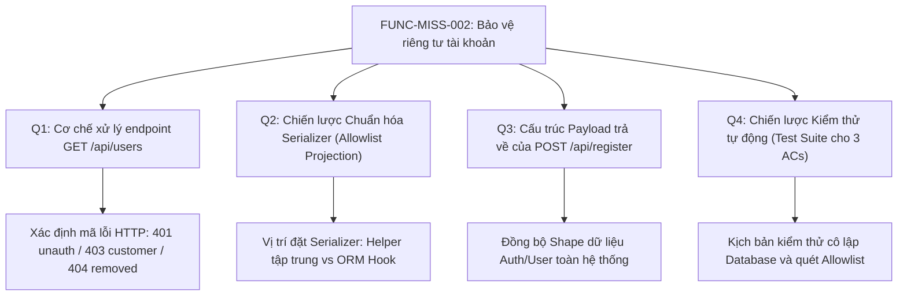

# Phỏng vấn kỹ thuật: Đóng danh sách người dùng công khai và loại hash khỏi response (FUNC-MISS-002)

- **Task ID:** `FUNC-MISS-002`
- **Tên task:** Đóng danh sách người dùng công khai và loại hash khỏi response
- **Module / Nhóm:** Riêng tư tài khoản / B. Chưa thực hiện / khắc phục
- **Mức độ ưu tiên:** P0 (Rào chắn: Truy cập, thanh toán hoặc toàn vẹn dữ liệu)
- **Độ phức tạp / Giai đoạn:** S (Ước lượng sơ bộ) / Giai đoạn 1
- **Ngày tạo:** 2026-11-20
- **Trạng thái:** Đã hoàn thành phỏng vấn toàn bộ quyết định Q1–Q8 và đạt được sự hiểu biết chung (Shared Understanding). Sẵn sàng chuyển sang lập Kế hoạch triển khai chi tiết (`docs/task-plans/2026-11-20-dong-danh-sach-user-loai-hash-plan.md`).

---

## 1. Căn cứ nghiệp vụ và Hiện trạng khảo sát

### 1.1. Căn cứ từ MasterPlan (`docs/TechStore_Master_Plan.xlsx`)
- **Hiện trạng thực tế:** `GET /api/users` không có middleware xác thực/phân quyền, `getAllUsers` chỉ loại bỏ password mà vẫn trả về toàn bộ thông tin nhạy cảm của người dùng khác (name, email, phone, address, role). `POST /api/register` trả `createdUser.toJSON()` trực tiếp, làm rò rỉ trường `password` chứa chuỗi băm bcrypt ra response.
- **Vấn đề / Rủi ro bảo mật:** Rò rỉ thông tin cá nhân khách hàng (PII) trên toàn bộ hệ thống; lộ hash mật khẩu trong luồng đăng ký tạo điều kiện cho kẻ tấn công thực hiện tấn công brute-force / tra cứu rainbow table ngoại tuyến.
- **Mục tiêu:** Public API không xuất dữ liệu người khác hoặc hash mật khẩu.
- **Tiêu chí nghiệm thu (Acceptance Criteria):**
  - **`FUNC-MISS-002-AC-01`**: Public/customer không thể liệt kê user. `GET /api/users` không có phiên hoặc với vai trò customer trả về 401/403/404; không trả danh sách, email, phone của người khác.
  - **`FUNC-MISS-002-AC-02`**: Response tài khoản chỉ có trường allowlist. Đăng ký, login, me, update profile khi quét các key không có password, password hash, OTP hash hoặc JWT thô.
  - **`FUNC-MISS-002-AC-03`**: Đăng ký hợp lệ vẫn tạo được tài khoản sau khi thay serializer. OTP hợp lệ, đăng ký trả về HTTP 201 với thông tin công khai an toàn, sau đó login thành công.
- **Ranh giới bàn giao:** Backend xử lý; chưa xây dựng màn hình quản lý user ở task này; Database schema không thay đổi.

### 1.2. Hiện trạng mã nguồn thực tế
1. `BE/src/routes/client/userRoutes.js:7`:
   `router.get("/", getAllUsers);` — Hoàn toàn không có middleware bảo vệ (`requireAuth` hay `requireAdmin`).
2. `BE/src/services/client/userService.js:3-9`:
   `getAllUsers` truy vấn `User.findAll({ attributes: { exclude: ["password"] } })` trả về toàn bộ danh sách người dùng gồm email, phone, address.
3. `BE/src/services/client/registerService.js:169`:
   `return createdUser.toJSON();` — Model instance sau khi `User.create` có trường `password: hashedPassword`, phương thức `toJSON()` mặc định biến đổi toàn bộ attributes dẫn đến hash mật khẩu bị đưa vào response.
4. `BE/src/services/client/userService.js:39-42`:
   `updateProfile` trả về `User.findByPk(userId, { attributes: { exclude: ["password"] } })` — Tiếp cận theo hướng "Blacklist" (chỉ exclude password), nếu DB sau này thêm cột token/code nội bộ sẽ bị lộ.

---

## 2. Cây quyết định (Design Tree)

---

## 3. Nội dung Phỏng vấn Vòng 1 (Frontier)

### ❓ Q1 - Cơ chế xử lý và phân quyền cho endpoint `GET /api/users`
**Bối cảnh:** Hiện tại endpoint `GET /api/users` đang mở hoàn toàn công khai. MasterPlan chỉ rõ: "bỏ truy cập public GET users, trả 401/403... Chưa xây màn hình quản lý user ở task này." Tiêu chí `AC-01` yêu cầu: truy cập không phiên hoặc với vai trò customer phải nhận mã lỗi 401/403/404 và không xem được danh sách người dùng khác.

Có ít nhất 3 lựa chọn kỹ thuật:
- **Option 1 (Áp dụng middleware `requireAuth` + `requireAdmin` lên route `GET /`):**
  - *Cơ chế:* Đặt `requireAuth` (trả 401 nếu chưa có phiên cookie) và `requireAdmin` (trả 403 nếu user không có role admin hoặc bị khóa) trước `getAllUsers`.
  - *Ưu điểm:* Đáp ứng chính xác tuyệt đối AC-01 (401 cho unauthenticated, 403 cho customer/staff); chuẩn bị sẵn sàng cho endpoint quản trị khi cần màn hình admin sau này; không làm xáo trộn cấu trúc route.
  - *Nhược điểm:* Giữ endpoint ở phân vùng `client/userRoutes.js` dù chỉ admin được gọi (tuy nhiên đúng với vị trí file hiện hành).
- **Option 2 (Xóa bỏ hoàn toàn route `GET /` khỏi `userRoutes.js` — trả về 404 Not Found):**
  - *Cơ chế:* Xóa bỏ dòng `router.get("/", getAllUsers);` khỏi `BE/src/routes/client/userRoutes.js`.
  - *Ưu điểm:* Triệt tiêu 100% attack surface, không để lộ sự tồn tại của endpoint vì hiện tại chưa có giao diện nào dùng đến danh sách này; đáp ứng nhánh "404" của AC-01.
  - *Nhược điểm:* Khi đến task `FUNC-ENH-012` (Quản trị tài khoản) sẽ phải viết lại route mới từ đầu; không phân biệt được lỗi chưa đăng nhập (401) hay sai quyền (403).
- **Option 3 (Chuyển endpoint sang `BE/src/routes/admin/userRoutes.js` và khóa hoàn toàn nhánh client):**
  - *Cơ chế:* Tạo router admin riêng `/api/admin/users`, bảo vệ bằng `requireAuth` + `requireAdmin`, đồng thời xóa route `GET /` ở client router.
  - *Ưu điểm:* Phân vùng kiến trúc sạch sẽ tuyệt đối giữa client và admin theo đúng tinh thần của `AGENTS.md`.
  - *Nhược điểm:* Mở rộng phạm vi tạo file mới ngoài dự kiến cho một task Scope S; vượt quá yêu cầu tối thiểu của baseline.

➡️ **Đề xuất khuyến nghị (Option 1):** Áp dụng middleware `requireAuth` và kiểm tra quyền Admin (`requireAdmin`) ngay tại `BE/src/routes/client/userRoutes.js:7`. Khách vãng lai nhận 401, tài khoản Customer nhận 403, đáp ứng trọn vẹn tiêu chí `FUNC-MISS-002-AC-01`.

---

### ❓ Q2 - Chiến lược Chuẩn hóa Serializer / Allowlist cho Dữ liệu Người dùng (User Projection)
**Bối cảnh:** `POST /api/register` trả `createdUser.toJSON()` trực tiếp làm lộ password hash. Trong khi đó, `userService.js:updateProfile` dùng `attributes: { exclude: ["password"] }` (phương pháp Blacklist — rủi ro cao nếu thêm cột mới). `AC-02` yêu cầu: Response tài khoản (đăng ký, login, me, update profile) chỉ có trường allowlist, không có password, password hash, OTP hash hoặc JWT thô.

Có ít nhất 3 lựa chọn kỹ thuật:
- **Option 1 (Xây dựng helper Serializer Allowlist tập trung tại `BE/src/utils/userSerializer.js`):**
  - *Cơ chế:* Định nghĩa hàm `sanitizeUser(user)` chỉ trích xuất các trường an toàn được phép công khai: `{ id, name, email, phone, address, avatar, role, created_at }`. Áp dụng hàm này tại `registerService`, `userService`, và đồng bộ với `authService`.
  - *Ưu điểm:* Tuân thủ nguyên tắc Allowlist (chỉ mở những gì đã xác thực là an toàn); độc lập với Sequelize; cực kỳ dễ viết unit test; không can thiệp vào tầng ORM nên không làm ảnh hưởng các query nghiệp vụ cần đọc password để verify (như `loginService`).
  - *Nhược điểm:* Cần gọi hàm chuyển đổi tại các service/controller trả dữ liệu người dùng.
- **Option 2 (Sử dụng Sequelize `defaultScope` hoặc override `User.prototype.toJSON` trên `userModel.js`):**
  - *Cơ chế:* Khai báo `defaultScope: { attributes: { exclude: ["password"] } }` hoặc ghi đè `toJSON()` trong model.
  - *Ưu điểm:* Tự động hóa toàn cục ở tầng ORM, mọi truy vấn hay chuyển đổi JSON đều tự động giấu mật khẩu mà không cần gọi hàm bọc.
  - *Nhược điểm:* Rất dễ gây xung đột hoặc break các luồng cần password hash như `authService.loginService` (buộc phải dùng `User.scope("withPassword")` phức tạp hóa truy vấn), dễ gây regression cho các tính năng hiện có.
- **Option 3 (Sửa cục bộ trực tiếp tại `registerService.js` và `userService.js`):**
  - *Cơ chế:* Tại `registerService.js:169`, thay `return createdUser.toJSON()` bằng object literal `{ id: createdUser.id, name: createdUser.name, email: createdUser.email, role: createdUser.role }`. Tại `userService.js`, sửa `attributes` thành danh sách cụ thể.
  - *Ưu điểm:* Số lượng dòng code thay đổi là tối thiểu, không thêm file mới.
  - *Nhược điểm:* Lặp lại code (vi phạm DRY), thiếu tính nhất quán; nếu có thêm endpoint người dùng mới sau này sẽ tiếp tục có nguy cơ rò rỉ vì không có một chuẩn mực duy nhất.

➡️ **Đề xuất khuyến nghị (Option 1):** Xây dựng helper `serializeUser` với Allowlist rõ ràng (`id`, `name`, `email`, `phone`, `address`, `avatar`, `role`, `created_at`). Áp dụng nhất quán vào `registerService.js`, `userService.js` (updateProfile), đảm bảo thỏa mãn 100% `FUNC-MISS-002-AC-02` mà không gây phản ứng phụ lên hệ thống xác thực.

---

### ❓ Q3 - Cấu trúc dữ liệu trả về của API Đăng ký (`POST /api/register`)
**Bối cảnh:** Sau khi đăng ký tài khoản thành công với OTP hợp lệ, controller hiện tại trả về: `res.status(201).json({ success: true, data: result })`. Tiêu chí `AC-03` yêu cầu: "Đăng ký hợp lệ vẫn tạo được tài khoản sau thay serializer; 201 với thông tin công khai; login thành công".

Có ít nhất 3 lựa chọn kỹ thuật:
- **Option 1 (Trả về 201 với Object User đã qua Serializer Allowlist):**
  - *Cấu trúc:* `{ success: true, data: { id, name, email, role, avatar, created_at } }`.
  - *Ưu điểm:* Giữ nguyên response shape (`data: { ... }`) mà frontend đang nhận, không làm gãy giao diện hoặc kiểm thử client; cung cấp đầy đủ thông tin an toàn của tài khoản vừa tạo; sạch bóng password hash.
  - *Nhược điểm:* Không có.
- **Option 2 (Trả về 201 chỉ kèm thông điệp thành công và định danh tối thiểu):**
  - *Cấu trúc:* `{ success: true, message: "Đăng ký thành công", data: { id, email } }`.
  - *Ưu điểm:* Cực kỳ tối giản thông tin.
  - *Nhược điểm:* Thay đổi shape dữ liệu so với hiện tại (thiếu các trường name, role...), có thể khiến code frontend xử lý sau đăng ký bị thiếu thuộc tính.
- **Option 3 (Trả về 201 kèm thiết lập luôn cookie phiên đăng nhập `auth_token`):**
  - *Cơ chế:* Sau khi tạo user, sinh JWT và set cookie `auth_token` tương tự `loginController`.
  - *Ưu điểm:* Người dùng đăng ký xong được tự động đăng nhập luôn mà không phải nhập lại mật khẩu.
  - *Nhược điểm:* Vượt quá phạm vi task `FUNC-MISS-002`; tiêu chí `AC-03` ghi rõ luồng nghiệp vụ là "Đăng ký rồi login" (2 bước tách biệt).

➡️ **Đề xuất khuyến nghị (Option 1):** Giữ nguyên contract HTTP 201 với payload `{ success: true, data: sanitizedUser }`, trong đó `sanitizedUser` chỉ chứa các trường an toàn trong allowlist, đáp ứng chuẩn mực `FUNC-MISS-002-AC-03`.

---

### ❓ Q4 - Chiến lược Kiểm thử tự động (Automated Test Suite)
**Bối cảnh:** Dự án sử dụng Node.js built-in test runner (`node --test tests/*.test.js`). Cần có bộ kiểm thử tự động để xác minh và bảo vệ toàn bộ 3 Tiêu chí nghiệm thu (AC-01, AC-02, AC-03).

Có ít nhất 3 lựa chọn kỹ thuật:
- **Option 1 (Tạo test suite tích hợp riêng `BE/tests/userPrivacy.test.js` với database test cô lập):**
  - *Cơ chế:* Kế thừa kiến trúc của `BE/tests/catalogAuthGuard.test.js`: tạo database cô lập `techstore_user_privacy_test_${process.pid}`, sync bảng, khởi chạy test server trên cổng ngẫu nhiên, thực hiện gọi API qua `fetch`.
  - *Nội dung kiểm tra:*
    1. `GET /api/users` không phiên -> nhận 401; với role customer -> nhận 403; với role admin -> nhận danh sách.
    2. Quét đệ quy toàn bộ JSON response của `register`, `login`, `me`, `profile` đảm bảo không có key nào trùng với `password`, `code_hash`, `token`.
    3. Đăng ký tài khoản mới bằng OTP -> nhận 201 -> dùng mật khẩu vừa tạo đăng nhập `POST /api/auth/login` thành công.
  - *Ưu điểm:* Kiểm chứng toàn diện end-to-end đúng như môi trường production; lưu lại bằng chứng kiểm thử tự động bền vững; hoàn toàn cô lập dữ liệu.
  - *Nhược điểm:* Cần môi trường MySQL khả dụng để chạy test tích hợp.
- **Option 2 (Chỉ viết Unit test cho hàm Serializer và Middleware Guard độc lập):**
  - *Cơ chế:* Mock các hàm Sequelize, chỉ test logic thuần túy của `serializeUser` và các middleware Express.
  - *Ưu điểm:* Chạy cực nhanh, không cần database MySQL.
  - *Nhược điểm:* Không kiểm chứng được sự kết hợp thực tế giữa Route, Middleware và Controller trên luồng HTTP thật, không đáp ứng trọn vẹn yêu cầu bằng chứng của MasterPlan.
- **Option 3 (Kết hợp cả Integration Test HTTP và Unit Test Serializer trong `BE/tests/userPrivacy.test.js`):**
  - *Cơ chế:* Viết test kiểm tra unit của serializer (quét object đầu ra) và test tích hợp toàn diện qua HTTP API.
  - *Ưu điểm:* Mức độ tin cậy và bảo vệ cao nhất.
  - *Nhược điểm:* Thêm một vài dòng test case nhưng chi phí phát triển không đáng kể.

➡️ **Đề xuất khuyến nghị (Option 3):** Xây dựng `BE/tests/userPrivacy.test.js` kiểm thử toàn diện cả unit logic của serializer lẫn integration qua HTTP request với test database cô lập, bao phủ trọn vẹn AC-01, AC-02 và AC-03.

---

## 4. Quyết định đã chốt trong phiên

- **Q1 (Xử lý endpoint GET /api/users):** Chốt **Option 1**. Áp dụng middleware `requireAuth` và kiểm tra quyền quản trị `requireAdmin` trực tiếp tại `BE/src/routes/client/userRoutes.js:7`. Khách vãng lai nhận `401 Unauthorized`, tài khoản khách hàng thông thường nhận `403 Forbidden`. Đáp ứng trọn vẹn `FUNC-MISS-002-AC-01`.
- **Q2 (Chiến lược Serializer Allowlist):** Chốt **Option 1**. Xây dựng helper serializer tập trung tại `BE/src/utils/userSerializer.js` theo nguyên tắc Allowlist (chỉ mở các trường an toàn), tách biệt khỏi ORM hooks để tránh gây lỗi cho `loginService` và đảm bảo an toàn tuyệt đối cho `FUNC-MISS-002-AC-02`.
- **Q3 (Payload API Đăng ký):** Chốt **Option 1**. `POST /api/register` giữ nguyên HTTP 201 với cấu trúc `{ success: true, data: sanitizedUser }`, trong đó `sanitizedUser` chỉ chứa các trường an toàn đã lọc qua serializer, đảm bảo tương thích ngược với Frontend và đáp ứng `FUNC-MISS-002-AC-03`.
- **Q4 (Chiến lược Kiểm thử):** Chốt **Option 3**. Xây dựng bộ test `BE/tests/userPrivacy.test.js` kết hợp cả Unit Test Serializer và Integration Test HTTP trên test database cô lập `techstore_user_privacy_test_${process.pid}`, kiểm chứng toàn diện cả 3 tiêu chí nghiệm thu (AC-01, AC-02, AC-03).
- **Q5 (Phân quyền chi tiết cho GET /api/users):** Chốt **Option 1**. Tái sử dụng middleware `requireAdmin` chuẩn mực của dự án (`role === "admin"` và `status === 1`). Tài khoản `staff` và `customer` đều nhận `403 Forbidden`; tài khoản admin bị khóa (`status = 0`) bị từ chối truy cập.
- **Q6 (Thiết kế cấp độ chiếu Serializer):** Chốt **Option 1**. Xây dựng `toPrivateUser` (trích xuất `{ id, name, email, phone, address, avatar, role, created_at }` cho chính chủ auth/me/profile/register) và `toPublicUser` (trích xuất `{ id, name, avatar, role }` cho hiển thị công khai).
- **Q7 (Phạm vi áp dụng Serializer):** Chốt **Option 1**. Đồng bộ hóa việc sử dụng serializer qua `registerService.js`, `userService.js` (`updateProfile`, `getAllUsers`) và `authService.js` (`meService`, `loginService`), loại bỏ hoàn toàn các cấu trúc Blacklist `attributes: { exclude: ['password'] }` cũ.
- **Q8 (Xử lý OTP trong môi trường Test):** Chốt **Option 1**. Sử dụng helper trong test suite chèn trực tiếp bản ghi OTP hợp lệ vào bảng `email_verification_codes` trên test database cô lập, đảm bảo test chạy 100% offline, ổn định, deterministic và không gửi mail thật ra ngoài.

---

## 5. Lịch sử câu hỏi phỏng vấn Vòng 2

### ❓ Q5 - Xử lý vai trò `staff` và trạng thái tài khoản `status` đối với `GET /api/users`
**Bối cảnh:** Bảng `users` có 3 vai trò: `admin`, `staff`, `customer` và trạng thái `status` (1 = active, 0 = locked). `requireAdmin` hiện có của BE (`BE/src/middleware/requireAdmin.js`) chỉ chấp nhận `role === "admin"` và `status === 1`. MasterPlan yêu cầu chưa xây dựng màn hình quản lý user ở task này.

Có ít nhất 3 lựa chọn kỹ thuật:
- **Option 1 (Chỉ Admin đang active (`role = 'admin'` và `status = 1`) mới được gọi `GET /api/users`; Staff và Customer đều nhận 403 Forbidden):**
  - *Lý do & Ưu điểm:* Dữ liệu cá nhân (PII) toàn bộ khách hàng là thông tin tối mật, chỉ SuperAdmin mới có thẩm quyền truy xuất; Staff không có lý do nghiệp vụ để đọc toàn bộ danh bạ; tài khoản bị khóa bị chặn tức thì. Tái sử dụng trực tiếp middleware `requireAdmin.js` chuẩn mực của dự án mà không cần sửa đổi.
  - *Nhược điểm:* Staff không xem được danh sách người dùng.
- **Option 2 (Cho phép cả Admin và Staff (`role in ['admin', 'staff']`) đang active truy cập):**
  - *Lý do & Ưu điểm:* Tương tự cơ chế Catalog Operator cho phép nhân viên vận hành hỗ trợ khách hàng.
  - *Nhược điểm:* Mở rộng phạm vi tiếp cận PII không cần thiết khi chưa có giao diện hay nghiệp vụ quy định cho Staff xem danh sách tài khoản.
- **Option 3 (Chỉ kiểm tra đăng nhập `requireAuth` mà không kiểm tra role/status):**
  - *Lý do & Ưu điểm:* Đơn giản nhất.
  - *Nhược điểm:* Vi phạm nghiêm trọng AC-01 vì tài khoản customer vẫn xem được danh sách người khác.

➡️ **Đề xuất khuyến nghị (Option 1):** Tái sử dụng middleware `requireAdmin` (yêu cầu `role === "admin"` và `status === 1`). Khách vãng lai nhận 401, Customer và Staff nhận 403.

---

### ❓ Q6 - Thiết kế Cấp độ Chiếu (Projection Levels) cho Helper `userSerializer.js`
**Bối cảnh:** Dữ liệu người dùng được trả về ở nhiều ngữ cảnh: khi đăng ký mới (chưa có phone/address), khi xem/sửa hồ sơ chính chủ (có phone/address), và khi hiển thị công khai (chỉ cần tên/avatar).

Có ít nhất 3 lựa chọn kỹ thuật:
- **Option 1 (Cung cấp 2 hàm chiếu rõ ràng theo ngữ cảnh bảo mật: `toPublicUser` và `toPrivateUser`):**
  - `toPublicUser(user)`: Trích xuất `{ id, name, avatar, role }` (dành cho hiển thị công khai).
  - `toPrivateUser(user)` / `toAuthUser(user)`: Trích xuất `{ id, name, email, phone, address, avatar, role, created_at }` (dành cho chính chủ khi login, me, register, updateProfile).
  - *Lý do & Ưu điểm:* Phân định ranh giới bảo mật rõ ràng theo ngữ cảnh (Contextual Allowlist); ngăn chặn tuyệt đối việc vô tình đưa `phone` hoặc `address` ra các API công khai trong tương lai; tuyệt đối không chứa `password` hay bất kỳ hash/token nào.
  - *Nhược điểm:* Cần gọi đúng tên hàm cho từng ngữ cảnh.
- **Option 2 (Chỉ định nghĩa 1 hàm duy nhất `serializeUser(user)` chứa toàn bộ các trường an toàn):**
  - Trích xuất: `{ id, name, email, phone, address, avatar, role, created_at }` cho mọi trường hợp.
  - *Lý do & Ưu điểm:* Cực kỳ đơn giản, chỉ 1 hàm duy nhất cho toàn bộ hệ thống.
  - *Nhược điểm:* Không phân biệt được giữa dữ liệu công khai và dữ liệu riêng tư của cá nhân.
- **Option 3 (Nhận mảng trường động từ bên ngoài: `serializeUser(user, allowedFields)`):**
  - *Lý do & Ưu điểm:* Tùy biến linh hoạt theo từng API.
  - *Nhược điểm:* Mất tính tập trung (Single Source of Truth); nếu lập trình viên sơ suất truyền `['password']` thì cơ chế allowlist bị bypass.

➡️ **Đề xuất khuyến nghị (Option 1):** Xây dựng `toPrivateUser` (cho auth/profile/register) và `toPublicUser` (cho dữ liệu công khai), đảm bảo ranh giới bảo mật ngữ cảnh rõ ràng và tuân thủ chặt chẽ Allowlist.

---

### ❓ Q7 - Phạm vi đồng bộ Serializer qua các Service liên quan (`userService`, `authService`)
**Bối cảnh:** Tiêu chí `FUNC-MISS-002-AC-02` yêu cầu: *"Response tài khoản (đăng ký, login, me, update profile) chỉ có trường allowlist. Đọc response và quét keys lồng nhau: Không có password, password hash, OTP hash hoặc JWT thô"*.

Có ít nhất 3 lựa chọn kỹ thuật:
- **Option 1 (Đồng bộ triệt để: Áp dụng serializer cho cả `registerService`, `userService` (`updateProfile`, `getAllUsers`) và `authService` (`meService`, `loginService`)):**
  - *Lý do & Ưu điểm:* Thỏa mãn 100% tiêu chí `AC-02`; gom toàn bộ logic lọc dữ liệu nhạy cảm về một đầu mối duy nhất; xóa bỏ hoàn toàn cách lọc thủ công và `attributes: { exclude: ['password'] }` cũ kỹ.
  - *Nhược điểm:* Chạm vào 3 file service, tuy nhiên mỗi file chỉ thay đổi 2-3 dòng gọi hàm serializer.
- **Option 2 (Chỉ áp dụng cho `registerService` và `userService.updateProfile`, giữ nguyên `authService`):**
  - *Lý do & Ưu điểm:* Giảm thiểu số file chỉnh sửa; `authService` hiện tại cũng đã lọc thủ công một số trường.
  - *Nhược điểm:* `authService` vẫn dùng code riêng rẽ, không đồng nhất kiến trúc.
- **Option 3 (Chỉ sửa duy nhất `registerService.js:169`):**
  - *Lý do & Ưu điểm:* Thay đổi tối thiểu nhất.
  - *Nhược điểm:* Không đạt `AC-02` vì `updateProfile` vẫn dùng Blacklist `exclude: ['password']` thay vì Allowlist.

➡️ **Đề xuất khuyến nghị (Option 1):** Đồng bộ hóa việc sử dụng serializer qua `registerService`, `userService` và `authService` để đảm bảo hệ thống đạt chuẩn AC-02 đồng nhất và bền vững.

---

### ❓ Q8 - Xử lý Mock Nodemailer và Cô lập Dữ liệu trong Test Suite `userPrivacy.test.js`
**Bối cảnh:** Trong luồng đăng ký, người dùng cần có OTP hợp lệ. Trong môi trường test tự động, việc gửi mail thật qua Nodemailer sẽ gây lỗi hoặc phụ thuộc mạng ngoài.

Có ít nhất 3 lựa chọn kỹ thuật:
- **Option 1 (Tạo helper chèn trực tiếp OTP hợp lệ vào bảng `email_verification_codes` trong test database cô lập):**
  - *Cơ chế:* Sinh chuỗi băm bcrypt của mã OTP (ví dụ `123456`) và chèn trực tiếp vào DB test với `expires_at` tương lai, sau đó gọi `POST /api/register` với mã này.
  - *Lý do & Ưu điểm:* Không cần gửi email thật, không phụ thuộc dịch vụ SMTP ngoài; test chạy 100% offline, ổn định, nhanh và kiểm chứng trọn vẹn luồng đăng ký thật ở backend theo đúng `AC-03`.
  - *Nhược điểm:* Cần viết vài dòng helper chèn OTP trong file test.
- **Option 2 (Sử dụng SMTP ảo bên ngoài như Ethereal Mail):**
  - *Lý do & Ưu điểm:* Chạy được cả hàm `sendVerificationCode`.
  - *Nhược điểm:* Cần kết nối mạng Internet, phụ thuộc third-party, dễ gây flaky test.
- **Option 3 (Bypass xác thực OTP bằng cách can thiệp code ứng dụng khi chạy test):**
  - *Lý do & Ưu điểm:* Không cần chèn DB hay gửi mail.
  - *Nhược điểm:* Làm biến dạng code logic production, vi phạm nguyên tắc kiểm thử khách quan.

➡️ **Đề xuất khuyến nghị (Option 1):** Sử dụng helper chèn trực tiếp OTP vào test database cô lập để kiểm thử luồng đăng ký tự động nhanh chóng, ổn định và không phụ thuộc mạng ngoài.

---

## 6. Kết luận và Ranh giới bàn giao (Shared Understanding)

Phiên phỏng vấn đã kết thúc thành công với sự thống nhất trọn vẹn (Shared Understanding) giữa các bên:
1. **Phạm vi thực hiện:**
   - Bảo vệ endpoint `GET /api/users` bằng middleware `requireAuth` và `requireAdmin`.
   - Tạo helper `BE/src/utils/userSerializer.js` (`toPrivateUser`, `toPublicUser`) áp dụng cơ chế Allowlist.
   - Chuẩn hóa response của `POST /api/register`, `PUT /api/users/profile`, `GET /api/users`, `GET /api/auth/me`, `POST /api/auth/login`.
   - Viết bộ regression & acceptance test `BE/tests/userPrivacy.test.js` kiểm chứng tự động cả 3 tiêu chí: `FUNC-MISS-002-AC-01`, `FUNC-MISS-002-AC-02`, `FUNC-MISS-002-AC-03`.
2. **Ranh giới không thực hiện (Out of Scope):**
   - Không thay đổi cấu trúc bảng cơ sở dữ liệu (`users`, `email_verification_codes`).
   - Không xây dựng màn hình giao diện quản lý người dùng phía Frontend ở task này (dành cho `FUNC-ENH-012` ở Phase 3).
3. **Bước kế tiếp:**
   - Lập Kế hoạch triển khai chi tiết (`docs/task-plans/2026-11-20-dong-danh-sach-user-loai-hash-plan.md`) theo chuẩn mực quy định tại `AGENTS.md`.

