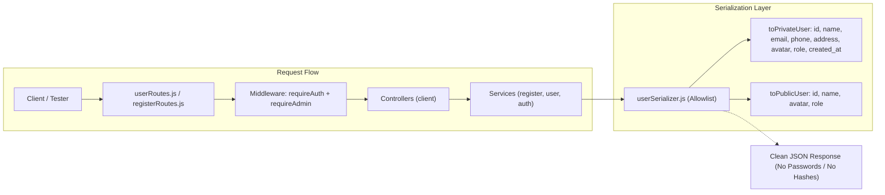

# Kế hoạch Triển khai: Đóng danh sách người dùng công khai và loại hash khỏi response (FUNC-MISS-002)

> **Trạng thái tài liệu:** Kế hoạch baseline sau phỏng vấn (Shared Understanding), tuân thủ [AGENTS.md](../../AGENTS.md) và biên bản phỏng vấn [docs/interviews/2026-11-20-dong-danh-sach-user-loai-hash-interview.md](../interviews/2026-11-20-dong-danh-sach-user-loai-hash-interview.md).  
> **Căn cứ nghiệp vụ:** [TechStore Master Plan](../../docs/TechStore_Master_Plan.xlsx) (Sheet Tổng quan, Chức năng, Tiêu chí kiểm thử, Lộ trình và phụ thuộc), [GLOSSARY.md](../../GLOSSARY.md).

---

## 1. Định vị trong Quy trình Phát triển và Ma trận Phụ thuộc

1. **Phân loại tác vụ:**
   - `FUNC-MISS-002` là tác vụ khắc phục lỗ hổng bảo mật và quyền riêng tư cấp thiết (**P0**) thuộc Nhóm B (*Chưa thực hiện / khắc phục*), Giai đoạn 1 (*Phase 1: Khởi động nền tảng bảo mật & riêng tư*) của MasterPlan.
   - **Độ phức tạp:** Mức **S** (Small/Scoped), tác vụ tập trung độc lập tại Backend.
   - **Phụ thuộc chặn trước (Dependencies):** Không có (Dependencies: *Không*).
   - **Tác vụ bị chặn tiếp theo (Downstream Blocked Tasks):** Là điều kiện tiên quyết của `FUNC-ENH-012` (*Quản trị tài khoản và phân quyền có audit* ở Giai đoạn 3).

2. **Lộ trình thực hiện:**
   - **Giai đoạn hiện tại (Plan & Align):** Thiết lập kế hoạch chi tiết, chốt ranh giới kỹ thuật, cấu trúc serializer và kịch bản kiểm thử tự động.
   - **Giai đoạn triển khai (TDD Implementation):** Triển khai theo phương pháp Test-Driven Development (Red → Green → Refactor) sử dụng Node.js test runner trên database cô lập.
   - **Giai đoạn đánh giá & bàn giao (Review & Change Log):** Kiểm tra `git diff`, chạy lint/syntax check, đối chiếu 100% tiêu chí nghiệm thu (AC-01, AC-02, AC-03) và lập báo cáo thay đổi theo quy chuẩn của `AGENTS.md`.

---

## 2. Thông tin Tác vụ từ MasterPlan Baseline

| Thuộc tính | Chi tiết từ MasterPlan Baseline |
| :--- | :--- |
| **Task ID** | `FUNC-MISS-002` |
| **Tên task** | Đóng danh sách người dùng công khai và loại hash khỏi response |
| **Module / Nhóm** | Riêng tư tài khoản / B. Chưa thực hiện / khắc phục |
| **Mức độ ưu tiên** | **P0** (Rào chắn: Truy cập, thanh toán hoặc toàn vẹn dữ liệu) |
| **Độ phức tạp** | **S** (Ước lượng sơ bộ, không phải deadline) |
| **Giai đoạn** | Giai đoạn 1 |
| **Hiện trạng thực tế** | `GET /api/users` không auth, `getAllUsers` chỉ `exclude: ["password"]`; `POST /api/register` trả `createdUser.toJSON()` trực tiếp. |
| **Vấn đề / Thiếu sót** | Hồ sơ name, email, phone, address, role có thể được liệt kê công khai; response đăng ký có thể chứa chuỗi băm mật khẩu bcrypt. |
| **Mục tiêu** | Public API không xuất dữ liệu người khác hoặc hash mật khẩu. |
| **Phạm vi công việc** | **Backend:** Bỏ truy cập public `GET users`, trả 401/403; serializer allowlist cho register/me/profile. Chưa xây màn hình quản lý user ở task này. **Database:** Không đổi. **Frontend:** Không đổi. |
| **Kết quả đầu ra** | API không lộ hồ sơ hoặc trường password/code_hash/token; bộ regression test tự động trên database cô lập. |

### Tiêu chí Nghiệm thu Chi tiết (Acceptance Criteria)

| Mã AC | Tên tiêu chí | Điều kiện thử nghiệm | Thao tác thực hiện | Kết quả kỳ vọng bắt buộc |
| :--- | :--- | :--- | :--- | :--- |
| **`FUNC-MISS-002-AC-01`** | Public/customer không thể liệt kê user | Môi trường thử nghiệm cô lập; dữ liệu giả; không dùng DB cửa hàng | Gọi `GET /api/users` không phiên hoặc với vai trò customer/staff | Nhận mã lỗi **401/403**; hoàn toàn không có danh sách, email, phone của người khác |
| **`FUNC-MISS-002-AC-02`** | Response tài khoản chỉ có trường allowlist | Môi trường thử nghiệm cô lập; dữ liệu giả | Đăng ký, login, me, update profile; đọc response và quét đệ quy các key | **Tuyệt đối không có** trường `password`, `password hash`, `code_hash` hoặc `token` |
| **`FUNC-MISS-002-AC-03`** | Đăng ký hợp lệ vẫn tạo được tài khoản sau thay serializer | Môi trường thử nghiệm cô lập; OTP hợp lệ; tài khoản mới | Đăng ký tài khoản (`POST /api/register`) sau đó dùng thông tin vừa tạo để đăng nhập (`POST /api/auth/login`) | Đăng ký trả về **HTTP 201** với thông tin công khai an toàn; đăng nhập thành công nhận **HTTP 200** |

---

## 3. Phân tích Hiện trạng Mã nguồn & Rủi ro Kỹ thuật

### 3.1. Điểm rò rỉ 1: Endpoint `GET /api/users` không có rào chắn bảo vệ
Tại `BE/src/routes/client/userRoutes.js` (Dòng 6–10):
```javascript
// Định nghĩa route để lấy tất cả người dùng
router.get("/", getAllUsers);

// PUT /api/users/profile — Cập nhật thông tin cá nhân (yêu cầu đăng nhập)
router.put("/profile", requireAuth, updateProfile);
```
- **Rủi ro:** `router.get("/", getAllUsers)` được khai báo mà không kèm theo bất kỳ middleware xác thực nào (`requireAuth` hay `requireAdmin`).
- Tại `BE/src/services/client/userService.js` (Dòng 3–9):
  ```javascript
  const getAllUsers = async () => {
    const users = await User.findAll({
      attributes: { exclude: ["password"] },
    });
    return users;
  };
  ```
  Truy vấn trả về toàn bộ người dùng trong cơ sở dữ liệu kèm theo: `id`, `name`, `email`, `phone`, `address`, `role`, `status`, `created_at`. Kẻ tấn công hoặc bất kỳ khách vãng lai nào cũng có thể tải về toàn bộ danh bạ khách hàng.

### 3.2. Điểm rò rỉ 2: API Đăng ký trả thẳng Model Instance chứa Password Hash
Tại `BE/src/services/client/registerService.js` (Dòng 163–170):
```javascript
const createdUser = await User.create({
  email: normalizedEmail,
  name: randomName,
  password: hashedPassword,
});

return createdUser.toJSON();
```
- **Rủi ro:** Khi tạo mới, `createdUser` chứa thuộc tính `password: hashedPassword` (chuỗi băm bcrypt). Phương thức `toJSON()` mặc định của Sequelize chuyển đổi toàn bộ attributes của model sang plain JSON object bao gồm cả thuộc tính `password`.
- Tại `BE/src/controllers/client/registerController.js` (Dòng 25–35):
  ```javascript
  const result = await registerUser({ email, password, code });
  res.status(201).json({ success: true, data: result });
  ```
  Toàn bộ `result` (có chứa `password`) được gói vào trường `data` trả về cho trình duyệt.

### 3.3. Điểm rủi ro kiến trúc: Lọc dữ liệu theo phương pháp Blacklist
Tại `BE/src/services/client/userService.js` (Dòng 39–43):
```javascript
const updatedUser = await User.findByPk(userId, {
  attributes: { exclude: ["password"] },
});
return updatedUser;
```
- `attributes: { exclude: ["password"] }` là kỹ thuật Blacklist (loại bỏ danh sách cấm). Nếu tương lai bảng `users` được bổ sung các cột nhạy cảm như `reset_password_token`, `verification_pin`, `auth_secret`, thì cơ chế blacklist này sẽ vô tình làm phơi bày các cột mới đó ra response.
- Cần chuyển đổi sang phương pháp **Allowlist** (chỉ cho phép các trường đã được kiểm duyệt an toàn).

---

## 4. Thiết kế Kiến trúc Kỹ thuật (Technical Architecture & Seam Design)



### 4.1. Module Serializer tập trung: `BE/src/utils/userSerializer.js`
Tạo mới file helper chuẩn hóa việc trích xuất dữ liệu người dùng tại `BE/src/utils/userSerializer.js`.

- **Danh mục trường Allowlist:**
  - `USER_PRIVATE_FIELDS = ["id", "name", "email", "phone", "address", "avatar", "role", "created_at"]`: Dành cho chính chủ khi đăng nhập, xem hồ sơ (`/me`), cập nhật hồ sơ (`/profile`), và khi vừa đăng ký tài khoản.
  - `USER_PUBLIC_FIELDS = ["id", "name", "avatar", "role"]`: Dành cho dữ liệu hiển thị công khai (nếu có sau này).
- **Nguyên lý hoạt động của `toPrivateUser(user)`:**
  1. Kiểm tra nếu `user` là null hoặc undefined ➡️ trả về `null`.
  2. Lấy dữ liệu thuần (plain object): nếu `user` có hàm `.toJSON()` hoặc `.get()` của Sequelize thì gọi để lấy plain object, ngược lại dùng `user` trực tiếp.
  3. Trích xuất đúng các trường trong `USER_PRIVATE_FIELDS`.
  4. Đảm bảo **100% không bao giờ** tồn tại trường `password`, `code_hash`, `token`.
- **Chữ ký hàm (Signature):**
  ```javascript
  const toPrivateUser = (user) => { ... };
  const toPublicUser = (user) => { ... };
  module.exports = { toPrivateUser, toPublicUser, USER_PRIVATE_FIELDS, USER_PUBLIC_FIELDS };
  ```

### 4.2. Bảo vệ Tuyến `GET /api/users` tại `BE/src/routes/client/userRoutes.js`
- Bổ sung middleware `requireAdmin` và `requireAuth` trước controller:
  ```javascript
  const requireAuth = require("../../middleware/requireAuth");
  const requireAdmin = require("../../middleware/requireAdmin");

  router.get("/", requireAuth, requireAdmin, getAllUsers);
  ```
- **Ma trận truy cập:**
  - Khách vãng lai (không có cookie `auth_token` hợp lệ) ➡️ `401 Unauthorized`.
  - Tài khoản `customer` hoặc `staff` ➡️ `403 Forbidden` ("Access denied. Admin only").
  - Tài khoản `admin` bị khóa (`status = 0`) ➡️ `403 Forbidden` ("Tài khoản đã bị khóa").
  - Tài khoản `admin` hoạt động (`role = "admin"`, `status = 1`) ➡️ `200 OK` với danh sách người dùng đã được serialize an toàn.

### 4.3. Đồng bộ hóa Serializer qua các tầng Service
1. **`BE/src/services/client/registerService.js`:**
   - Thay thế `return createdUser.toJSON();` bằng:
     ```javascript
     const { toPrivateUser } = require("../../utils/userSerializer");
     ...
     return toPrivateUser(createdUser);
     ```
2. **`BE/src/services/client/userService.js`:**
   - Trong `updateProfile`: thay vì trả thẳng `updatedUser` từ `findByPk`, trả qua `toPrivateUser(updatedUser)`.
   - Trong `getAllUsers`: trích xuất mảng qua `users.map((u) => toPrivateUser(u))`.
3. **`BE/src/services/client/authService.js`:**
   - Đồng bộ `meService` và `loginService` sử dụng `toPrivateUser(user)` để đảm bảo mọi response tài khoản trên toàn bộ hệ thống đều xuất phát từ cùng một định dạng chuẩn mực.

---

## 5. Danh sách File Thay đổi và Ranh giới Dự án

### 5.1. File Tạo mới
| Đường dẫn file | Mục đích |
| :--- | :--- |
| `BE/src/utils/userSerializer.js` | Helper serializer tập trung trích xuất user theo nguyên tắc Allowlist an toàn |
| `BE/tests/userPrivacy.test.js` | Test suite tự động bao phủ 3 tiêu chí nghiệm thu AC-01, AC-02, AC-03 |

### 5.2. File Chỉnh sửa
| Đường dẫn file | Thành phần thay đổi | Mục đích |
| :--- | :--- | :--- |
| `BE/src/routes/client/userRoutes.js` | Thêm `requireAdmin` vào `GET /` | Chặn truy cập công khai và khách hàng thường vào danh bạ user |
| `BE/src/services/client/registerService.js` | Hàm `registerUser` | Áp dụng `toPrivateUser` loại bỏ bcrypt hash khỏi kết quả đăng ký |
| `BE/src/services/client/userService.js` | Hàm `updateProfile` và `getAllUsers` | Áp dụng `toPrivateUser` thay thế cơ chế blacklist |
| `BE/src/services/client/authService.js` | Hàm `loginService` và `meService` | Đồng bộ dữ liệu trả về thông qua `toPrivateUser` |

### 5.3. Ranh giới không can thiệp (Out of Scope)
- **Database Schema:** Không thay đổi, không tạo migration mới; cấu trúc bảng `users` và `email_verification_codes` giữ nguyên.
- **Frontend Code:** Không chỉnh sửa bất kỳ file nào trong `FE/my-app/`; giữ nguyên contract response để Frontend hoạt động trơn tru.
- **Giao diện Quản trị User:** Chưa xây dựng màn hình danh sách tài khoản (thuộc task `FUNC-ENH-012`).

---

## 6. Kế hoạch Triển khai theo Phương pháp TDD (Red → Green → Refactor)

### Bước 1: Khởi tạo Helper Serializer và Unit Test (RED ➡️ GREEN)
- Tạo file `BE/src/utils/userSerializer.js`.
- Viết Unit test trong `BE/tests/userPrivacy.test.js` kiểm tra:
  - Input rỗng / null / undefined ➡️ trả về null.
  - Sequelize model instance hoặc plain object có trường `password` ➡️ output trích xuất đúng allowlist và **hoàn toàn biến mất trường `password`**.

### Bước 2: Thiết lập Test Database Cô lập & Viết Integration Tests (RED)
- Trong `BE/tests/userPrivacy.test.js`, thiết lập schema database test độc lập `techstore_user_privacy_test_${process.pid}`.
- Viết test case cho `FUNC-MISS-002-AC-01`: Gọi `GET /api/users` không token (kỳ vọng 401), có token customer (kỳ vọng 403). Hiện tại route chưa có guard ➡️ **Test báo FAIL (RED)**.
- Viết test case cho `FUNC-MISS-002-AC-02` & `AC-03`: Tạo bản ghi OTP trong DB test, gọi `POST /api/register`, quét đệ quy các key của response kiểm tra không có `password`. Hiện tại register đang trả password hash ➡️ **Test báo FAIL (RED)**.

### Bước 3: Áp dụng Guard cho Route `userRoutes.js` (GREEN 1)
- Import `requireAdmin` vào `BE/src/routes/client/userRoutes.js` và bảo vệ tuyến `router.get("/", requireAuth, requireAdmin, getAllUsers)`.
- Chạy lại test ➡️ Test case `FUNC-MISS-002-AC-01` chuyển sang **PASS (GREEN)**.

### Bước 4: Áp dụng `toPrivateUser` cho `registerService`, `userService`, `authService` (GREEN 2)
- Cập nhật `BE/src/services/client/registerService.js:169` chuyển sang `toPrivateUser(createdUser)`.
- Cập nhật `BE/src/services/client/userService.js` (`updateProfile`, `getAllUsers`) và `BE/src/services/client/authService.js`.
- Chạy lại test ➡️ Test case `FUNC-MISS-002-AC-02` và `FUNC-MISS-002-AC-03` chuyển sang **PASS (GREEN)**.

### Bước 5: Refactor và Chạy Toàn bộ Kiểm tra Hệ thống
- Đảm bảo tuân thủ chuẩn CommonJS, thụt lề 2 spaces, double quotes, arrow functions theo [AGENTS.md](../../AGENTS.md).
- Chạy toàn bộ regression test suite của Backend: `node --test tests/*.test.js`.

---

## 7. Rủi ro, Kịch bản Biên (Edge Cases) và Biện pháp Phòng ngừa

| STT | Tình huống biên (Edge Case) | Rủi ro tiềm ẩn | Biện pháp phòng ngừa kỹ thuật |
| :--- | :--- | :--- | :--- |
| 1 | Input truyền vào serializer không phải Sequelize model instance mà là plain object hoặc mảng | Gây lỗi `user.get is not a function` hoặc `user.toJSON is not a function` (HTTP 500) | Trong serializer kiểm tra `typeof user.get === "function" ? user.get({ plain: true }) : (typeof user.toJSON === "function" ? user.toJSON() : { ...user })`. |
| 2 | Tài khoản Admin nhưng trạng thái bị khóa (`status = 0`) gọi `GET /api/users` | Lọt quyền nếu middleware chỉ kiểm tra `role === "admin"` | `requireAdmin.js` đã kiểm tra đồng thời cả `user.role === "admin"` VÀ `user.status === 1`. Thêm test case xác nhận admin bị khóa nhận `403`. |
| 3 | Tài khoản đăng ký mới chưa có `phone` hoặc `address` | Thuộc tính bị `null` hoặc `undefined` gây vỡ giao diện nếu ép kiểu | Allowlist giữ nguyên giá trị `null` nếu trường đó chưa có giá trị, không làm mất key hoặc gây lỗi null pointer. |
| 4 | Cạnh tranh dữ liệu email trong luồng đăng ký | 2 request đăng ký cùng lúc với cùng 1 email | Model `users` có ràng buộc `unique: true` trên cột `email`, service kiểm tra trùng trước khi hash và create. |
| 5 | Quét key đệ quy kiểm tra dữ liệu nhạy cảm | Bỏ sót trường nhạy cảm lồng trong object con (nested object) | Test suite duyệt đệ quy (recursive scan) qua toàn bộ cây JSON của response để xác nhận không chứa bất kỳ từ khóa cấm nào (`password`, `code_hash`, `token`). |

---

## 8. Kế hoạch Kiểm tra Chất lượng (Quality Assurance Checklist theo AGENTS.md)

Trước khi nghiệm thu bàn giao:
- [ ] **Kiểm tra ranh giới:** Không sửa đổi file ngoài phạm vi task; không thay đổi schema database; Frontend giữ nguyên.
- [ ] **Kiểm tra chuẩn mã nguồn:** Backend viết CommonJS (`require` / `module.exports`); hàm viết arrow function tách rời export; thụt lề 2 spaces; dấu nháy kép `"`; không dùng `var`.
- [ ] **Kiểm tra cú pháp:** Chạy `node --check` cho toàn bộ các file JS mới và file JS được chỉnh sửa.
- [ ] **Kiểm tra kiểm thử tự động:** Toàn bộ test suite `BE/tests/userPrivacy.test.js` chạy đạt 100% Pass trên database cô lập.
- [ ] **Đối chiếu Tiêu chí Nghiệm thu:**
  - `FUNC-MISS-002-AC-01`: Đạt (Có bằng chứng test HTTP 401/403).
  - `FUNC-MISS-002-AC-02`: Đạt (Có bằng chứng recursive scan JSON response).
  - `FUNC-MISS-002-AC-03`: Đạt (Có bằng chứng đăng ký 201 an toàn và đăng nhập 200).
- [ ] **Tài liệu bàn giao:** Lập báo cáo thay đổi `docs/code-changes/2026-11-20-dong-danh-sach-user-loai-hash-change-log.md` ghi nhận kết quả thực tế.

## 9. Đối chiếu tính khả thi trước triển khai

- `requireAdmin` hiện chỉ đọc `id` và `role`. Hai tuyến kiểm duyệt review cũng dùng guard này. Tách logic kiểm tra chung vào `createAdminGuard.js` và thêm `requireActiveAdmin.js` chỉ gắn vào `GET /api/users`. Biến thể mới kiểm tra `role` và `status` từ cùng bản ghi, trả thông báo 403 theo mục 4.2 và chuyển lỗi đọc DB tới error handler chung.
- `login` xác minh mật khẩu bằng bcrypt và đưa JWT vào cookie HTTP-only qua controller. Backend tiếp tục dùng hash và token nội bộ. Serializer chỉ tạo object người dùng trả về; các envelope HTTP giữ cấu trúc hiện hành. Các truy vấn đọc hồ sơ dùng chung danh sách trường cho phép.
- Node.js và MySQL cục bộ đã chạy được một bài kiểm thử catalog trên schema riêng. Bộ test mới dùng schema riêng theo tiến trình, mô hình Sequelize thật và OTP giả đã băm. Tiêu chí AC-01 đến AC-03 giữ nguyên.
